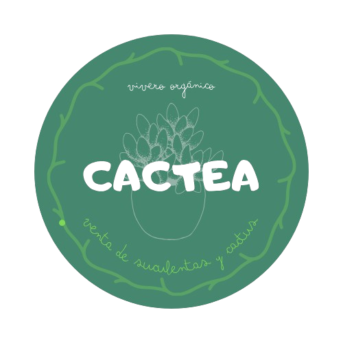

<p align="center">
  
</p>

<h1 align="center">Cactea</h1>

<p align="center"><strong>Vivero orgánico · Suculentas y cactus cultivados con cariño</strong></p>

<p align="center">
  Un pequeño oasis nacido en una terraza del suburbio de Guayaquil. En Cactea reunimos
  plantas que alegran casa, oficina y regalos, junto con todo lo necesario para elegirlas,
  pedirlas y cuidarlas sin salir de la página.
</p>

> “Cada planta contiene una parte del corazón de todos los que conformamos Cactea.”

---

## Descripción

Cactea es la vidriera digital de un vivero orgánico especializado en suculentas y cactus.
El sitio muestra el catálogo real del vivero, cuenta nuestra historia, comparte consejos de
cuidado y acerca el emprendimiento a quienes buscan una planta con personalidad.

La experiencia combina una interfaz cercana y verde con herramientas prácticas: explorar,
elegir, consultar y pedir. Detrás de esa simplicidad hay una API que mantiene el catálogo y
los mensajes al día, protege el panel del vivero y da vida a un asistente que conoce las
plantas disponibles.

---

## Qué ofrece la página

- **Catálogo desde la base de datos** 🌵 — productos reales, con filtros por suculentas,
  cactus y regalos, más una selección de destacados.
- **Pedido por WhatsApp** 💬 — arma tu pedido, ajusta cantidades, mira el total y envía el
  resumen directamente al vivero.
- **Sección de cuidados** 🌱 — guías claras para que cada suculenta y cada cactus crezca
  sano y feliz.
- **Formulario de contacto** ✉️ — dudas, pedidos especiales y mensajes que quedan guardados
  para responderlos con calma.
- **Panel de administrador** 🔐 — acceso con login para gestionar productos y revisar los
  mensajes recibidos.
- **Asistente con IA** ✨ — un chat que consulta el catálogo antes de recomendar y te ayuda
  a elegir con criterio.
- **Diseño responsive** 📱 — la misma experiencia cuidada en escritorio, tablet y móvil.

---

## Paleta de marca

| Verde profundo | Verde hoja | Gris suave | Crema | Verde claro |
| :---: | :---: | :---: | :---: | :---: |
| `#46876F` | `#678F73` | `#737373` | `#E0E5CF` | `#C1D1B5` |

---

## Estructura del proyecto

```text
cactea_emprendimiento/
├── backend/     # API, modelos, rutas y asistente con IA
├── frontend/    # sitio público, panel administrador y estilos
└── docs/        # material de apoyo del proyecto
```

Dos mundos que trabajan juntos: la cara visible de Cactea y el motor que la mantiene viva.

---

## Tecnologías usadas


---

## Autora

Creado con cariño por **Gabriela Ortiz**.

[Ver el repositorio en GitHub](https://github.com/Gabrielaaaa-coder/cactea_emprendimiento)

Cactea sigue creciendo planta por planta. 🌿
